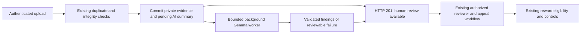

# Gemma hackathon benchmark

## Additional local CPU speed experiment (2026-10-16)

The user requested that images stay local. Hardware inspection found an Intel
i7-10610U (four cores/eight threads) and Intel UHD graphics; Ollama reported
zero VRAM in use. The current foreground run previously completed in 184.839 s.

`node backend/scripts/gemma-speed-probe.js` tested a shorter prompt, one
side-by-side image instead of two image inputs, eight CPU threads, a 128-token
processing batch, and a 160-token output cap, using the same labeled source
illustrations. The model request took **144.304 s**, but output hit the token
limit and contained incomplete JSON. It failed validation and was **not enabled
in the application**. This is not a speed improvement for valid verification.
Combining images also loses detail and has not been validated on real photos.

The raw experiment is [fast-layout-probe.json](demo/gemma/benchmarks/fast-layout-probe.json).
The experiment waited for the current uploader's inference before starting;
frontend checks ran during part of the experiment, so it is not an isolated
performance comparison. No images were sent to a hosted service. Reliable
seconds-long local verification has not been demonstrated on this hardware;
the application retains its validated configuration and human-review controls.

## Earlier controlled experiments

All measurements here use the same two **labeled illustrations**, never real
cleanup photographs. The owner confirmed that consented real before/after
photographs are unavailable. Real-photo accuracy and camera/GPS validation remain
pending. No environmental impact or physically verified waste categories are
claimed from these drawings.

## Baseline profile

The original [live record](demo/gemma/live-inference.json) completed in 303.113 s
using local Ollama 0.40.5, `gemma3:4b` Q4_K_M, CPU, and a 4096-token context.
Both original image SHA-256 hashes are recorded in every benchmark. Model digest:
`68ceab7e468a31c988b44d5a4984a0e21f58c4f7158c6ce29c1804babac38df7`.

| Baseline component | Measured time | Interpretation |
| --- | ---: | --- |
| Model loading | 0.0085 s | Model was already loaded; not the main delay in this run |
| Prompt/image evaluation | 161.654 s | Dominant cost, 981 prompt tokens; includes visual processing |
| Token generation | 118.212 s | 537 generated tokens; excessive repeated findings increased output |
| Other provider time | 22.871 s | Provider total minus the reported stages; not assigned to an invented stage |
| Application/HTTP remainder | 0.368 s | Includes untimed preprocessing and heuristic checks; cannot isolate them retrospectively |

The baseline did not time preprocessing separately. New runs do: resizing and
EXIF-free JPEG encoding took tens of milliseconds on these small drawings.
Reducing upload size did not reduce the 512 visual tokens in the two-image
prompt. Gemma 3 normalizes images internally to 896×896 and encodes an image as
256 tokens; additional crops can change that on other inputs. See the
[Google model card](https://ai.google.dev/gemma/docs/core/model_card_3).

## Method

`backend/scripts/gemma-benchmark.js` sends actual sequential requests to loopback
Ollama, using temperature 0, seed 42, identical source image hashes, JPEG quality
80, and no external images or credentials. It saves exact prompts, schemas,
options, raw responses, input hashes, payload sizes, preprocessing times,
provider timings, token counts and cache counts under
[`docs/demo/gemma/benchmarks`](demo/gemma/benchmarks).

The historical run predates this harness. The resize-only variant preserves its
prompt, schema and output cap. The first compact policy removes the schema text
from the prompt, bounds lists, limits output to 384 tokens, and explicitly tests
2048-token context, 4 versus 8 threads and repeat penalty 1.1. These are bundled
configuration comparisons, not claims about the independent effect of each
setting. In the 256-token variant the output cap did not bind; its shorter
latency must not be attributed to the cap.

The first matrix leaves the model loaded, to expose both warm-model and cached
repeat behavior. The matched `--cold` runs explicitly unload the model before
each request and verify the unloaded state. OS disk caching may still persist.
The summary revalidates raw output against **that run's own schema** and applies
the final conservative quality heuristics separately. This corrects an early
harness check that applied the new application validator to a legacy-schema run;
raw responses and measured times remain unmodified.

These are single runs on one illustration pair, not a statistical accuracy or
performance study. OS/background load and development checks were not fully
isolated. Recheck small timing differences and multiple real photo pairs before
choosing production defaults. A low latency with many cached tokens is a best
case, not evidence that a new photo pair will fit the 45-second default deadline.

## Measured comparison

Hardware: Intel Core i7-10610U, 8 logical CPUs, 16.94 GB installed RAM, CPU
inference. Same model digest and same source image hashes throughout. Image sizes
are maximum edges; the original 960×640 illustrations are not enlarged.
Wall time includes preprocessing and output handling. Provider stage times are
listed separately in the [machine-readable summary](demo/gemma/benchmarks/summary.json).

| Configuration | Wall time | Prompt / cached tokens | Generated tokens | Observed quality |
| --- | ---: | ---: | ---: | --- |
| Historical original, 1024 max, 1800-token cap | 303.1 s | 981 / 0 | 537 | Repeated findings, incorrect markers-in-both claim, unsupported organic category |
| Original, controlled cold rerun | 300.6 s | 981 / 0 | 537 | Same problems; valid JSON is not visual accuracy |
| Resize only, 512 max | 229.4 s | 981 / 0 | 250 | Incorrect road changes and contradictory cleanup conclusion |
| Compact v1, 1024 max, 384 cap, context 2048, 4 threads | 232.2 s | 796 / 0 | 231 | No repeated entries; unsupported road/material claims and incorrect illustration conclusion |
| Compact v1, 512 max, same settings | 210.2 s | 796 / 0 | 152 | Unsupported material inference and contradictory conclusion |
| Compact v1, 512 max, 256 cap | 42.8 s | 796 / **791** | 175 | Cached repeat; still an incorrect illustration conclusion; cap did not bind |
| Compact v1, 512 max, 384 cap, 8 threads | 185.1 s | 796 / 0 | 148 | Faster in this run, but still failed quality checks; runner reload included |
| Grounded v2, 1024 max, controlled cold | 227.5 s | 756 / 0 | 195 | Rejected: repeated categories/findings and placeholder text |
| **Final example-based v3, 1024 max, controlled cold application workflow** | **191.7 s** | **765 / 0** | **96** | **Schema and quality checks passed; illustrative, uncertain, empty material categories** |

The failed native-fetch attempt spent 304.8 seconds without a usable response;
it is retained as a failure, not a successful row above. The first workflow
attempt found a hidden-directory image-delivery issue and is retained separately
as [the failed storage workflow](demo/gemma/workflow-failed-storage.json).

The final measured reduction versus the matched cold original is **36.2%**
(300.645 → 191.701 seconds), or **36.8%** versus the historical 303.113-second
baseline. This is a bundled configuration result on this pair, not a promise
about arbitrary cleanup photographs. Generation fell from 537 to 96 tokens;
the output cap was not reached. Shorter, constrained findings—not simply lowering
the cap—reduced the work in these runs.

For the final run, preprocessing was 0.021 s, loading 29.505 s, prompt/image
evaluation 141.720 s, and generation 20.333 s. Prompt/image evaluation now accounts
for roughly 74% of total time. Preprocessing is not the bottleneck. The uncached
CPU result still exceeds 45 seconds, so the background workflow is essential.

## Selected configuration and tradeoffs

The application defaults retain 1024 max image edge, use a 384-token output cap,
2048-token context, 4 threads, temperature 0, seed 42 and repeat penalty 1.1.
It keeps the model loaded for ten minutes between requests. Integer settings
are bounded and configurable in `backend/.env.example`. The final example-based
policy is `grounded-example-v3`; reports record that revision and effective
settings. Ordinary application deadline remains 45000 ms; the documented CPU
demo sets 600000 ms. Neither deadline blocks the upload response.

- 512-pixel uploads save bytes but did not reduce image-token count, and may
  hide small litter in future real photos. The final configuration retains
  image detail rather than selecting 512 solely from a single latency number.
- Eight threads were faster for a v1 run, but that run failed the quality checks.
  The final v3 workflow was measured with four threads; its eight-thread variant
  has not been measured. There is no claim that four threads are globally fastest.
- One finding per text list reduces repetition and tokens, while limiting detail
  on complex scenes. Multiple waste categories remain supported. Reviewers must
  consult the images; future real-photo testing must evaluate missed small items
  and insufficient detail as well as false positives.
- A cached repeat can fall below 45 seconds; a new pair did not. Preloading a
  model alone does not eliminate visual encoding or generation costs.
- The final illustration result is more conservative and passed the selected
  checks, but these observations are not a real-world waste-detection accuracy
  measurement. No real cleanup photographs were used.

## Executed application workflow

The [real-model workflow record](demo/gemma/workflow-live.json) passed. It used
the final settings above, a deliberately unloaded model, a fresh isolated
database and actual HTTP routes. The initial upload returned in **234.1 ms**
with saved private evidence and a pending assessment. Completion was observed
at 192.5 s; AI service time was 191.7 s. These are different measurements.

Verified checks: anonymous record access 401; other-user image access 403;
owner image access 200 with `private, no-store`; exact duplicate rejection with
AI skipped; no automatic approval; model output validation; unauthorized review
denied; authorized reviewer decisions; one successful appeal followed by a 409
for a second appeal; and zero paid rewards. The scripted approval is solely an
isolated synthetic workflow test, not approval of a real cleanup or a real human
evaluation of model accuracy.

Authenticated evidence delivery now explicitly supports a hidden ancestor in
the configured storage directory after root containment and owner/admin checks.
It does not change public static-file handling. A regression test covers this
case and the original failure report is retained.



For a short hackathon presentation, start an upload, demonstrate the pending
state and independent human review, and show a clearly labeled recorded inference
result with its actual timing. Allow more than three minutes if waiting for a
fresh CPU analysis live. Do not present a recorded result or a cached repeat as
a new uncached inference, or these illustrations as real cleanup evidence.

One native-fetch cold baseline attempt failed with `TypeError` at 304.75 s,
before its configured 600-second application deadline. Its exact cause code was
not captured by the early harness. This is consistent with a separate transport
headers deadline (Undici documents a 300-second default), but the retained
record alone does not prove the cause. See the
[Undici client documentation](https://github.com/nodejs/undici/blob/main/docs/docs/api/Client.md).
The adapter and harness now use the already installed `node-fetch` dependency
with an application AbortSignal covering headers and body. A loopback transport
test verifies abort during delayed headers, and the full baseline rerun completed
in 300.6 s. The failed run remains in the artifacts and is not counted as a
successful latency measurement. See
[node-fetch v2 documentation](https://github.com/node-fetch/node-fetch/tree/2.x#readme).

## Quality and application behavior

The original output repeats entries, claims removed colored markers exist in
both images, and labels organic waste without visual support. The first compact
outputs omit repetition in these runs but still invent a road-shape change or
material categories and sometimes contradict their own cleanup evidence field.
These errors are preserved in the raw records.

The second revised policy put illustrative-image handling first and limited
lists to two findings, but its cold run still returned duplicate categories,
duplicate findings and placeholder text. That failed candidate is retained in
the report rather than presented as a successful optimization. The final policy
uses a compact JSON example and at most one finding per text list. It asks for
independently observed differences and prohibits
invented measurements and road/sky changes, and excludes normal trees/grass from
organic waste. Explicitly illustrative assessments must remain uncertain.
Conservative output checks detect selected contradictions, exact/near repeats,
numeric measurement claims and unsupported organic categories. They cannot
prove visual truth or general waste-detection accuracy. The server always forces
human review, regardless of the model's boolean.

The durable background worker saves pending work with private evidence before
starting inference. Uploads no longer await the AI deadline. Timeout, malformed,
truncated and flagged outputs remain reviewable; duplicate rejection, ownership
checks, admin-only decisions, appeals and Celo reward mechanisms remain in place.
Only pending work is recovered after restart; completed failures do not retry
indefinitely. The worker currently targets one API process, not distributed
multi-replica scheduling.

## Reproduction

With local Ollama and `gemma3:4b` available, from `backend`:

```powershell
npm run gemma:benchmark -- resize-only-512 compact-1024-384 compact-512-384 compact-512-256 compact-512-threads8
npm run gemma:benchmark -- --cold baseline-repeat grounded-v3-1024
npm run gemma:benchmark:summary
npm run gemma:workflow -- --cold
npm test -- --runInBand
npm run lint
```

`baseline-config.json` and `compact-v1-config.json` freeze the old policies for
reproduction. Revised runs record the actual current policy alongside the raw
output. The workflow command uses temporary local demo actors and a fresh
isolated database under ignored `.local-inference/`, never the production DB.
Rewards are disabled/dry-run. Real model responses are used; the illustrative
findings fixture is not substituted for inference.
The isolated workflow runs under `NODE_ENV=test`, with real authentication and
authorization but disabled test-mode rate limiting. It is not a production load
test or a browser/camera hardware test.

For future real-photo testing, use explicit consented files outside tracked
directories with `gemma:smoke`, independent reviewer labels, several viewpoints,
no-change/different-scene cases, and hazardous/ambiguous items. Measure false
positives and missed litter, not just whether JSON validates. The current data
cannot establish real-world detection accuracy.

## Final validation and remaining limits

Executed after the integration changes: backend **20 suites / 133 tests passed**;
frontend **5 suites / 18 tests passed**; backend and frontend lint passed;
production web export and PWA validation passed. The real-model isolated API
workflow above also passed. `git diff --check` passed. No commits or pushes were
made. No new runtime dependency was needed.

Validation ran on the available Node 24.19.0 runtime; the repository specifies
Node 22, so rerun checks under Node 22 before deployment. Consented real-photo
accuracy, phone camera/GPS behavior, hosted inference compatibility, PostgreSQL
worker behavior and distributed worker scheduling have not been validated by
this demonstration. No Celo transaction or real reward payout was performed.
